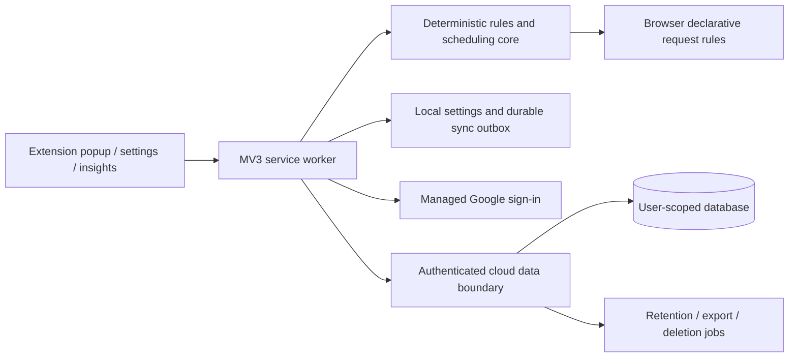

# Take Reins architecture proposal

Status: Draft for review. Google sign-in and online profile/settings/statistics sync are user requirements. Provider, detailed data fields, stack and feature scope remain unapproved. This is an original design, not a claim about BlockSite's private backend.

## Component boundaries

Recommended behavior for approval: blocking uses the last valid local configuration, so a cloud outage does not disable the user's rules. The service worker owns validation, rule updates and synchronization; UI and content scripts do not receive privileged backend credentials.

The backend supplies identity integration, user isolation, versioned settings, usage aggregation, device registration, export/deletion and operational controls. It is not a proxy for ordinary web browsing. Browser enforcement remains inside each installed extension.

## Extension design

- Pure core: URL normalization, matching, allow/block precedence, schedules, focus state and rule compilation. Final precedence rules require explicit specification.
- Browser adapter: declarative network rules, alarms, storage, toolbar/popup and notifications where approved.
- Packaged original UI: onboarding, list editor, schedules, focus controls, insights and account/sync status. A public web dashboard is an optional separate scope decision.
- Local storage: last valid config, schema version, queued changes, per-device usage checkpoints and sync cursor. Consider IndexedDB for a larger outbox; select after workload measurement.
- Reconcile browser rules after install, startup, config changes, alarm delivery and time changes. Derive remaining durations from timestamps rather than relying only on a running timer.
- Prototype custom blocked-page redirects with required host permissions and web-accessible resources. Measure rule limits on the chosen browser baseline. Do not copy BlockSite's broad permission set without necessity.

Chrome's DNR API supports declarative blocking/redirects and persistent dynamic rules. See [DNR reference](https://developer.chrome.com/docs/extensions/reference/api/declarativeNetRequest). Keep per-browser API differences behind the adapter and verify in both brands; see [Edge compatibility guidance](https://learn.microsoft.com/en-us/microsoft-edge/extensions/developer-guide/port-chrome-extension).

## Authentication

1. The user explicitly clicks Continue with Google.
2. Start a provider-supported OAuth/OIDC authorization-code flow with PKCE through an approved browser authentication flow. Register exact development, Chrome-store and Edge-store redirect identities separately.
3. The managed identity provider validates Google authentication and issues an application session. Use stable provider user IDs, not mutable email addresses, as ownership keys.
4. Check token issuer, audience, expiry and signature at the authenticated data boundary. Reject expired tokens and unauthorized account/device operations.
5. Restrict session access to trusted extension contexts. Keep secrets and privileged provider keys server-side; never put a client secret in the extension. Choose persistence and refresh behavior explicitly during the auth spike.
6. Test cancellation, wrong callback/state, replay, refresh, sign-out, account switching and revoked sessions. Account switching must not upload a previous user's queued data.

Edge does not support `identity.getAuthToken`; its documentation points to `launchWebAuthFlow` as an alternative. A Chrome-only Google token implementation is insufficient. Sources: [Chrome identity](https://developer.chrome.com/docs/extensions/reference/api/identity), [Edge API support](https://learn.microsoft.com/en-us/microsoft-edge/extensions/developer-guide/api-support), [OAuth security BCP](https://www.rfc-editor.org/rfc/rfc9700).

## Proposed online data model

These are candidate fields, pending the user's field-level decisions. Never copy existing BlockSite account data into Take Reins without explicit authorization.

| Entity | Candidate fields | Ownership/constraints |
| --- | --- | --- |
| Profile | user ID, display name, email reference, optional avatar URL, time zone, created/updated times | User-owned; identity email changes handled by auth provider |
| Device | random installation ID, user ID, browser type, version, last sync | No hardware fingerprint; revocable |
| Settings | user ID, schema version, revision, approved preferences | Server-managed revision; field whitelist |
| Rule | user ID, stable rule ID, type, normalized target, enabled, revision, tombstone | Validated shape; no arbitrary executable code |
| Schedule | user ID, schedule ID, rule references, days, local times, time-zone policy, revision | Referential integrity and boundary validation |
| Focus preferences | user ID, approved focus/break settings | Sync preferences; active session sync is a separate decision |
| Usage bucket | user ID, device ID, date/time-zone context, optional domain/category, cumulative active duration, counter version | Unique logical bucket key; bounded nonnegative values |
| Sync operation | user ID, device ID, operation ID, base revision, payload version, result | Idempotent; bounded retention |
| Consent/preferences | user ID, statistics detail level, retention, private-mode policy, policy version | Data use follows explicit settings |

Use database authorization policies/security rules for user isolation even when the client accesses a managed data API directly. Do not trust a user ID supplied in a request body. Index owner/date/revision access paths; forbid broad cross-user listing.

## Backend contracts

Logical operations below may be implemented as managed database operations plus trusted functions, rather than a separate always-on server. Publish schemas/OpenAPI contracts after choosing the backend.

| Operation | Responsibility | Required behavior |
| --- | --- | --- |
| Read/update own profile | Profile service | Authenticated ownership, allowed fields only |
| Register/revoke own device | Device service | A revoked device cannot continue server writes |
| Push config changes | Sync service | Validate, check base revision, deduplicate operation, commit atomically |
| Pull changes since cursor | Sync service | Paginated authorized changes including deletions |
| Upsert usage batch | Statistics service | Idempotent per-device bucket updates; strict batch limits |
| Query usage summary | Statistics service | Date-bounded query, explicit time zone, paginated detail |
| Export own data | Account service | Complete user-scoped export with version metadata |
| Delete account/data | Trusted lifecycle service | Reauthentication, session revocation, resumable cleanup, no stale-client resurrection |

## Synchronization proposal

- Save locally first and queue an operation with installation ID, operation ID and base revision. Acknowledge only after a durable local write.
- Server accepts an operation atomically or returns a conflict; retries do not apply it twice. Use server revisions rather than trusting client clock order.
- Preserve deletions with tombstones and define cursor expiry so a long-offline device cannot restore deleted records.
- Surface first-login and concurrent-edit conflicts. Do not silently replace local rules with cloud defaults. Final merge behavior needs approval.
- Pull deltas on app open, sign-in, successful mutation and a bounded periodic cadence. Batch usage rather than upload on every tab event. Reconnect with capped exponential backoff and jitter.
- Keep the last working configuration during quota errors or outages. Display queued/pending/conflict states honestly.
- Upload cumulative per-device usage buckets using monotonically increasing versions. Retried batches replace the same bucket rather than adding its duration again. Summing browsers measures combined activity, which can differ from unique human screen time; ask which metric is wanted.
- Test schedule/time-zone semantics and usage midnight boundaries independently of cloud storage timestamps.

## Statistics privacy and cost

Recommend domain-level or category-level aggregates, with no full URL paths, query strings, page content or incognito activity uploaded. This is a proposal requiring user confirmation. Define active time using focused window/active tab/idle state, then verify it on real browsers. Do not label blocked-time estimates as measured time saved without a documented calculation.

Storage and transfer are minimized by bounded retention, per-day buckets, pagination, incremental sync and batched writes. User-requested usage statistics are distinct from product telemetry; telemetry is not authorized.

## Hosting comparison

Prices checked 2026-10-25 America/Toronto. USD where a paid price is quoted. Free tiers have limits; no provider can be called universally cheapest without expected usage and retention.

| Option | Current entry cost and limits | Fit and tradeoff |
| --- | --- | --- |
| Supabase Free | $0; 50,000 MAU, 500 MB database, 5 GB egress; project may pause after one week of inactivity | Managed Google auth and SQL authorization; candidate for an inexpensive pilot. Pro begins at $25/month, so the next cost step matters |
| Firebase Spark | No-cost plan; Firestore includes 1 GiB, 50k reads/day and 20k writes/day; Google authentication available | Candidate for Google-based pilot; operations and queries must fit quotas. Trusted Cloud Functions need Blaze billing; account cleanup/retention must not be hand-waved |
| Cloudflare Workers + D1 | Free tiers: 100k Worker requests/day; D1 5 GB total, 5m rows read/day and 100k rows written/day | Cheap custom API/database candidate; authentication integration and server authorization add development/maintenance. Worker paid entry is $5/month plus applicable usage |

Recommendation for review: prototype managed Google authentication and user-scoped storage on Supabase Free or Firebase Spark before selecting a provider. Both can begin at $0 within limits. Prefer an option that passes Chrome/Edge auth, account lifecycle, statistics quotas and cost tests with the least custom security code. Do not deploy multiple providers merely to use their free tiers. Extension UI is bundled, so it does not itself need recurring web hosting. Hosting is needed only for the approved backend, auth callback/help/privacy surfaces and any approved web dashboard.

Sources: [Supabase pricing](https://supabase.com/pricing), [Google sign-in on Supabase](https://supabase.com/docs/guides/auth/social-sign-in/auth-google), [Firebase pricing](https://firebase.google.com/pricing), [Firebase extension authentication](https://firebase.google.com/docs/auth/web/chrome-extension), [Workers pricing](https://developers.cloudflare.com/workers/platform/pricing/), [D1 pricing](https://developers.cloudflare.com/d1/platform/pricing/).

## Deployment and operations

- Separate local/test and production environments and identities. Test data must be synthetic.
- Version database migrations and authorization policies with code; test denied access as well as successful access.
- CI runs unit, integration, schema/security-policy checks and extension builds. Protect deployment secrets and redact tokens/domain data from logs.
- Prepare provider usage estimates from active users × devices × sync cadence × buckets/day × retention. Include query reads, indexes, backup storage, egress and any functions.
- Set quota alerts and document quota-exhaustion behavior. Budget alerts are not assumed to be a hard billing cap. No paid upgrade without an agreed ceiling.
- Verify exports, backup/restore and deletion; free-tier restore/retention limitations must be explicit before production acceptance.
- Use the GitHub approval and publishing gates in [workflow](../workflow.md). No cloud resources or GitHub repositories have been created by this plan.
